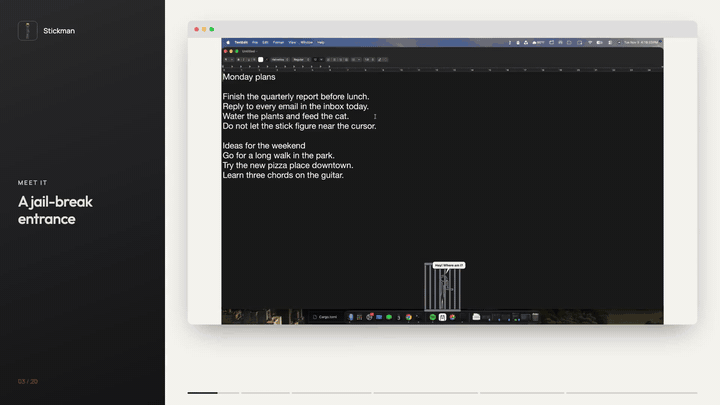
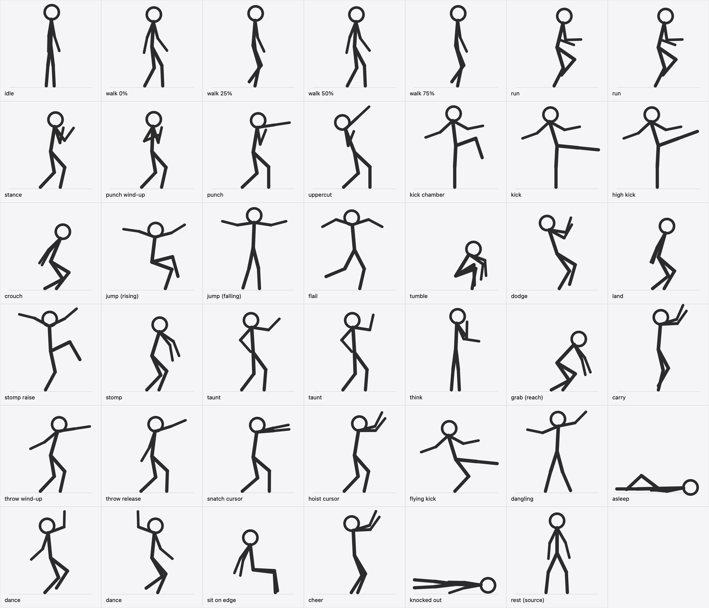
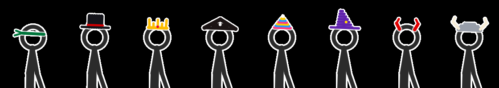

# Stickman



A native macOS desktop companion: a stick figure that lives on top of your desktop.
It walks along the Dock, climbs onto your windows, stands on lines of text, dodges
your mouse, fights your cursor (and sometimes grabs it and throws it across the
screen), gets knocked flying when you click it, and stomps on whatever window
you're working in. It talks in speech bubbles, makes cartoon sound effects, and
roams across all your displays. A **local** LLM running in Ollama decides its mood.

Written in Rust for Apple Silicon:
- **Overlay window:** `winit` + AppKit (`objc`).
- **Rendering:** `wgpu` (Metal).
- **Collision world:** `rapier2d`.
- **AI director:** `tokio` + `reqwest`, talking to Ollama.
- **Text detection:** Apple's Vision framework.



## What it does

| | |
|---|---|
| **Overlay** | Borderless, fully transparent windows over every display, always on top (`NSStatusWindowLevel`), on every Space, including over full-screen apps. No Dock icon, never steals focus. |
| **Click-through** | Every click passes to the app underneath, except when you deliberately aim at the figure (the cursor moves onto it and hovers for 120 ms). Clicks meant for your app aren't stolen when the figure wanders under a parked cursor. |
| **Walking** | Procedural gait with planted feet (no sliding), two-bone IK knees, hip bob and counter-swinging arms. Running uses a longer stride, high knees and pumping arms. |
| **Climbing** | Window title bars are one-way platforms (occluded parts removed), as are lines of text found by OCR in the active window. The figure jumps up onto them, walks along them, rides them when you drag the window, and falls when it walks off the edge or you close the window. |
| **Combat** | Click the figure: it's knocked flying with an explosion, spins, bounces and gets back up, and a small health bar appears. Clicks land mid-air too (juggling). Enough hits knock it out, with stars. Swipe fast at it and it dodges. In combat mode it chases the cursor and punches or kicks it, physically shoving your pointer. |
| **Word throwing** | In combat the figure jumps onto lines of text in your active window (any app, web pages included), rips a whole word right off the screen and lobs it at your cursor. The word flies as the real pixels, spinning, knocks the pointer and falls to the Dock. Where it was taken from, the page looks blank: the overlay paints the exact on-screen background colour over it. Nothing in the real app changes, and the gap heals when the window scrolls, moves or loses focus, or after 45 s. In sabotage mode it steals words and flings them away. |
| **Jail-break intro** | It starts locked in a steel cell: rattles the bars ("Let me out!"), grumbles, kicks the door off in an explosion of flying bars, then comes for your cursor. Click it while it's locked up to blast the cell open early. Plays again on Respawn. |
| **Super powers** | **Super jump:** a glowing power-up crouch, then a leap of up to ~1000 pt with a trail and a shockwave, to reach a cursor up high, a far-off window or a word. **Telekinesis:** hand out, purple aura: it lifts your pointer, wobbles it in the air and flings it; or raises a group of up to 6 words off the page, keeps them orbiting overhead, then fires them at your cursor one after another. |
| **A mind of its own** | It remembers what you do to it (and in which app), and it develops feelings toward you: resentment, fear, affection, pride. Every couple of minutes it reflects on its memories with the local AI and rewrites its own beliefs ("The user hits me most in Safari"), a scheme ("Operation Pointer Doom: …") and the next note it wants to leave you. All of that feeds back into how it decides what to do: a small, local take on self-improving agent harnesses like Google's Harness². Kept in `mind.json`; see it, or wipe it, in Settings → Mind. |
| **Losing its temper** | Push its resentment past 75 and it snaps ("THAT'S IT! F*** YOU!"): it flushes red, steams from the head, swears whatever its language (bleeped unless you turn bleeping off; never slurs), spells "F*** YOU" in torn-off letters, and attacks relentlessly until its resentment drops below 55 (petting helps). Switch off with "Loses its temper". |
| **A diary** | Every day it tallies what happened; when the date changes, the local AI writes a short, dramatic "Dear diary" entry about yesterday (or a rule-based one when Ollama is off). It reads the opening aloud when you're back, and keeps 60 days of entries on the Mind tab. **Write Diary Now** writes today's so far. |
| **Achievements & hats** | 17 achievements (First Blood, Pickpocket, Icon Thief, Window Wrecker, Swordsman, Duelist, Desk Champion, Beloved, Seething, Pen Pal, Philosopher, Veteran, …), each celebrated with a trophy bubble and sparks. Levels and achievements unlock 8 hats it can wear (ninja bandana, top hat, crown, pirate hat, party hat, wizard hat, devil horns, viking helmet); pick one in Personality, where locked ones say how to earn them. |
| **Moves you unlock** | Like a game, it starts with just its fists: super jump at level 2, telekinesis at 3, scrollbar swords at 4, window throwing at 5. Each level-up announces what it unlocked. Untick **Earn moves by levelling up** to have everything from the start. |
| **Polite on calls, sleepy at night** | While any app is using a camera (a video call, most likely) it whispers "Shh… you're on a call", then goes silent and harmless: no speech, sound, notes or rivals, nothing done to your cursor or windows. It only checks whether a camera is running; it never opens one. After 11 pm it nods off four times sooner. Both can be switched off. |
| **Ransom notes** | It spells messages to you with letters torn off your screen, each one cut out with a scrap of its page; letters that aren't on screen become coloured cut-outs. The message depends on its mood, its mode and its last reflection ("I REMEMBER YOU", "PLEASE STOP", "FIGHT ME"). |
| **Throwing windows** | With telekinesis it can lift your active window, wobble it in the air and hurl it at your cursor (or fling it aside); it bounces off the screen edges and slides to a stop, always kept on screen. |
| **Dock icons and swords** | Standing on the Dock it rips app icons up from under its feet and throws them (copies; your Dock is untouched). In combat it rips a scrollbar off your window and fights with it as a sword, then hurls it. |
| **Rival duels** | Every 6–12 minutes (or via **Summon a Rival**), a red ninja stick figure drops in on the far side: "You! Me! Now!" The two fight each other with the full combat moveset (punches, kicks, leaps, super jumps); no healing mid-duel. Click either one to join in. Knock the rival out for a big experience bonus; then it limps off screen ("I'll be back!"). |
| **Boss fights** | Now and then in a fight (from level 3), or with **Start a Boss Fight**, it declares "BOSS FIGHT!": a banner and a big red health bar for your cursor appear at the top of the screen. Every punch, sword hit, thrown word or icon, and cursor toss knocks the bar down; you fight back by clicking the figure. Empty the cursor's bar and it wins (explosion, "I AM THE CHAMPION!", double experience); knock it out first and you win. 90 s, then it's a draw. |
| **Minion army** | From level 6 it sometimes yells "Minions! ATTACK!" and three small allies (blue, green, orange) drop in to gang up on your cursor for 25 s, then walk home. One or two clicks knock a minion out in a puff of smoke. Or press **Call the Minions**. |
| **Piles** | Thrown words and icons that land settle flat and become tiny platforms: later throws land on top, piles grow, and the figure can climb them. Best with "Thrown words stay: Forever". |
| **Levels & grudges** | Experience from fights levels it up (Doodle → Scrapper → Brawler → Champion → Legend) for more health and a quicker step. Hitting it builds a grudge that fades slowly, makes it fiercer, and is remembered between launches ("Remember me? I remember YOU."). |
| **Draw for it** | **Draw Platforms** (⌘D): sketch lines with the mouse to make platforms; hold Shift for a trampoline that bounces it high. Right-click to finish. |
| **Dances to music** | When your Mac is playing audio, it dances along. |
| **Personality** | Name, temper (gentle ↔ fierce), chattiness, colour, and language: Polite, Cheeky or Salty (it swears, bleeped as `#$%&!` unless you turn that off; never slurs or anything hateful). The AI director is told all of it. |
| **Pick it up** | Press on the figure and drag: it dangles from your pointer by the scruff of the neck, swinging as you move ("Hey! Put me down!"). Let go with a flick and it flies off with your mouse's speed, tumbling and bouncing; hard throws hurt. A quick click is still a hit. |
| **Naps** | Leave the computer for a while and it lies down on its back, knee up, with a "Zzz" over its head. Move the mouse and it wakes with a start ("I wasn't sleeping!"). |
| **Petting** | Stroke it slowly with the cursor and it cheers, hearts float up, and it calms down and heals. |
| **Hobbies** | Now and then, while idle, it sits on the edge of a window or text line with its legs dangling, breaks into a little dance, or draws a doodle in the air with a marker (heart, smiley, star, house, sun, spiral) that fades after 30 s. |
| **Flying kick** | In combat, when your cursor hovers above it, the figure leaps and kicks it in mid-air. |
| **Grab & throw the cursor** | In combat, a slow cursor within reach is sometimes snatched with both hands, hoisted overhead and lobbed across the screen: your real pointer is pinned to its hands, then flies along the arc. Yank the mouse away or click the figure to escape; a hold never lasts more than 3 s. Only while *Punches Push My Cursor* is on. |
| **Speech bubbles** | The AI director gives the figure a short line when its mood changes ("That's it. It's on!"), and it quips when hit, knocked out, dodging, grabbing or throwing. |
| **Sound** | Punches, kicks, whooshes, knockback booms, landing thuds, pops, stomps, a talking babble and a knockout wah-wah, all synthesised in code (no audio files) and panned by where they happen. Volume slider in Fun & Sound. |
| **Multiple displays** | One overlay per screen. Each screen has its own floor (the Dock top, or the screen bottom), and windows on every screen are platforms. The figure wanders across a shared screen edge, dropping down when the next screen's floor is lower; an edge that would be a step up is a wall. Plugging in or rearranging displays is picked up within 2 s. |
| **Sabotage** | It climbs onto your active window and stomps on it, shaking the window via Accessibility, or kicks it so the window slides across the screen (it rides along, and the window never leaves its screen). |
| **AI director** | Every 4 s a local Ollama model (`llama3.2:1b` by default, ~200–300 ms) picks `IDLE` / `OBSERVE` / `SABOTAGE` / `COMBAT` from what you're doing: active app, mouse speed, hits, health, frustration, idle time. Modes last at least 12 s, except immediate retaliation after a hit. If Ollama is down, a built-in director takes over. |
| **Efficiency** | 60 Hz simulation when something moves, 30 Hz otherwise; frames that wouldn't visibly change are skipped. Idle ≈ 2–3% of one core (PRD budget 5%), walking ≈ 13–16%. |



## How it learns and remembers

The figure has a long-term memory and a psychology that carry over between
launches (`mind.json`, next to the settings). It doesn't retrain a model: the
local LLM's weights never change. Instead it keeps rewriting the notes it
brings into every decision, a small, local take on self-improving agent
harnesses.

1. **It remembers everything you do to it.** Every hit, throw, knockout, pet,
   blow it lands on the cursor, cursor escape, duel and long silence is stored
   with the time and the app you were in. It keeps the last 300 events plus
   lifetime totals, and counts which app you hit it in most.
2. **Each memory moves its feelings.** Four feelings, 0–100:
   - **Resentment** rises when you hit or throw it and falls when you pet it.
   - **Fear** rises after a beating (four quick hits scare it more than one)
     and after a lost duel.
   - **Affection** rises with petting and falls when it's hit or ignored.
   - **Pride** rises when it lands blows, throws the cursor or wins duels, and
     falls when it's knocked out.

   They drift slowly back toward neutral, about 0.6 points a minute. A grudge
   score in `stats.json` works the same way and greets you on the next launch
   ("Remember me? I remember YOU.").
3. **Feelings change how it behaves.** Resentment makes it fiercer; fear and
   affection calm it down. The bias is added to its temper slider.
   Resentment over 75 and it **loses its temper** (red, steaming, swearing,
   all-out attack) until resentment falls below 55.
   **It remembers where it got hurt.** Once you've hit it 3+ times in one app
   (the app where you hit it most), switching to that app sets it off. If fear
   wins, it flinches back, says "Oh no. Not Google Chrome again…", gets off
   that window and hides at the far side of the screen; it won't sabotage that
   window. If resentment wins (or it's enraged), it goes after the window
   instead: climbs it, stomps it, shoves it, and leaves notes like
   "I HATE CHROME". The beatings leave a scar, so a much-abused app stays
   scary after its feelings have calmed down; petting it heals that. In a
   fight it still hits back.
4. **It reflects and draws conclusions.** About every 2½ minutes, it hands
   the local AI a summary of its memories and feelings and asks what it now
   believes. The answer rewrites:
   - its **beliefs** about you ("The user hits me most in Safari");
   - its **scheme** ("Operation Pointer Doom: …"), which it sometimes says out loud;
   - the next **ransom note** it wants to spell with letters torn off your screen;
   - its **inner thought**.

   Without Ollama, simple rules over the same memories do this instead.
5. **The conclusions feed its next decisions.** The memory summary, beliefs,
   scheme and mood go into every prompt the AI director gets, so what it
   learned shapes which mood it picks next (calm, observing, sabotage or
   combat). Then the loop repeats: new events → new feelings → a new
   reflection.
6. **It keeps a diary and earns a record.**
   - Each day ends with a diary entry about what you did to it.
   - Achievements, levels and unlocked moves track its history with you.

**Watch it think** in Settings → Mind: live feeling bars (yellow, then red),
its current thought, beliefs, scheme, next note, a log of memories and
thoughts, and the diary. **Reflect Now** forces a reflection. **Wipe Its
Memory** makes it forget everything ("Huh? Who am I?"), and **Forgive & Reset
Level** clears its experience and grudge.

## Settings window

**Settings…** (⌘,) in the menu bar opens a window with every option, in four
tabs with headed sections:

| Tab | What's there |
|---|---|
| Mind | Live: its mood and level; bars for resentment, fear, grudge, affection, pride, health and experience (yellow, then red when they get bad); what it's thinking right now, its scheme, beliefs and next note; a log of its thoughts and memories; its diary; achievements earned and what to go for next; Reflect Now, Leave Me a Note, Write Diary Now, Wipe Its Memory, Forgive & Reset Level. |
| Personality | Name, colour, size, hat; temper and chattiness sliders, language, bleeping, losing its temper; behaviour (Auto or one pinned mood), quiet during video calls, sleepy at night, earn moves by levelling up. |
| Abilities | Your cursor (pushes, grabs), your windows (shakes, shoves, throws), your screen (walking on text, ripping words and how long they stay, Dock icons, scrollbar swords, piles), powers and events (super powers, jail-break intro, rival visits, minions, boss fights, with Start a Boss Fight and Call the Minions buttons). |
| Fun & Sound | Naps, dancing, dancing to music, doodles, sitting on edges, speech bubbles, sound effects and their volume. |

Everything is saved and restored on the next launch. Environment variables
below override settings at startup.

## Menu bar

A little stickman icon sits in the menu bar. Its pose shows the figure's mood:
standing (idle), hand on chin (observing), knee up (sabotage), fists up
(combat). The menu keeps the essentials:

| Item | What it does |
|---|---|
| Mood / Health / AI | Live status: mood and the director's reason, health, level and grudge, whether Ollama is online. |
| Settings… (⌘,) | The Settings window. |
| Behaviour ▸ | Auto (AI director), or pin Idle, Observe, Sabotage or Combat. |
| Draw Platforms (⌘D) · Leave Me a Note (⌘N) · Summon a Rival | Quick actions. |
| Show Figure (⌘H) · Pause (⌘P) · Respawn (⌘R) | Hide, freeze or reset the figure. |
| Grant … | Shortcuts to System Settings, shown only while a permission is missing. |
| Quit (⌘Q) | Quit the app. |

## Requirements

- macOS on Apple Silicon (`aarch64-apple-darwin`). Developed on an M1 Max.
- Rust 1.85+.
- Optional: [Ollama](https://ollama.com) running locally with a small model, e.g.
  `ollama pull llama3.2:1b`. Without it, the built-in director is used.
- Permissions, granted to the app or terminal that launches it (System Settings →
  Privacy & Security):
  - **Accessibility:** stomps shake windows.
  - **Screen Recording:** OCR, so the figure can walk on text.

  Both are optional; the figure works without them. macOS asks on first launch.

## Run

```sh
cargo run --release
```

There's no Dock icon; use the menu bar icon (**Quit**, ⌘Q) or Ctrl+C in the
launching terminal.

### Environment variables

| Variable | Effect |
|---|---|
| `STICKMAN_MODE=IDLE\|OBSERVE\|SABOTAGE\|COMBAT` | Force a mode (director off). |
| `STICKMAN_OLLAMA_MODEL` | Ollama model (default `llama3.2:1b`). |
| `STICKMAN_OLLAMA_URL` | Ollama URL (default `http://localhost:11434`). |
| `STICKMAN_DIRECTOR_INTERVAL_S` | Seconds between director decisions (default 4). |
| `STICKMAN_NO_CURSOR_PUSH=1` | Punches don't move your pointer. |
| `STICKMAN_NO_WINDOW_SHAKE=1` | Nothing moves your windows (no shakes, shoves or throws). |
| `STICKMAN_NO_OCR=1` | Don't read screen text (no walking on text). |
| `STICKMAN_NO_PROMPTS=1` | Never show macOS permission dialogs. |
| `STICKMAN_NO_SOUND=1` | No sound effects. |
| `STICKMAN_NO_INTRO=1` | Skip the jail-break intro. |
| `STICKMAN_HOLD_IDLE=1` | Stand still (used to measure idle CPU). |
| `STICKMAN_SETTINGS` | Settings file path (default `~/Library/Application Support/Stickman/settings.json`). |
| `STICKMAN_CLICK_THROUGH=0` | Debug: the overlay catches every click (blocks the screen). |
| `STICKMAN_DEBUG_OPEN_MENU=1` | Debug: pop the menu bar menu open once at startup. |
| `STICKMAN_DEBUG_SAY="…"` | Debug: say this line at startup. |
| `STICKMAN_DEBUG_DO=sleep\|dance\|cheer\|doodle\|superjump\|mindwords\|throwwindow\|rival\|draw\|sketch\|note\|reflect\|rage\|diary\|boss\|minions` | Debug: do that 3 s after launch. |
| `STICKMAN_DEBUG_OPEN_SETTINGS=1` | Debug: open the Settings window at launch (or `=Mind`, `=Abilities`, … for that tab). |
| `STICKMAN_DEBUG_HAT=Crown` | Debug: wear that hat even if it's locked (`Bandana`, `TopHat`, `Pirate`, `Party`, `Wizard`, `Horns`, `Viking`). |
| `STICKMAN_DEBUG_GRAB=1` | Debug: in combat, always grab a slow cursor in reach (instead of 30% of the time). |
| `RUST_LOG=debug` | Verbose logs: director decisions, OCR, perf stats, click-through toggles. |

## Testing

```sh
cargo test --release                       # everything (PRD CPU budget enforced)
cargo test --release --test overlay -- ocr # one GUI test by name
STICKMAN_INTERACTIVE_TESTS=1 cargo test --release --test overlay -- click  # hands off the mouse
STICKMAN_INTERACTIVE_TESTS=1 cargo test --release --test overlay -- grabs  # cursor grab & throw
STICKMAN_INTERACTIVE_TESTS=1 cargo test --release --test overlay -- drag   # pick up & fling
cargo clippy --all-targets -- -D warnings
cargo run --release --example pose_sheet -- docs/poses.png   # re-render the pose sheet
cargo run --release --example sfx_demo     # hear every sound effect
```

**Unit tests (190).**
- **Collision:** one-way landings, no tunnelling, window-edge occlusion clipping.
- **Walking and running:** feet never slide; feet always on the ground.
- **Poses:** IK accuracy and knee direction; hands and arms never cross the head.
- **Combat:** knockback, juggling into a KO, getting back up, chasing and hitting
  the cursor, dodging fast swipes, snatching and throwing the cursor, letting go
  when the user yanks free or clicks, flying kicks.
- **Being handled:** hanging under a dragged pointer, flying off when let go,
  dropping gently when set down; staying on its own text line when the text is
  re-read.
- **Powers and the intro:** super jumps reach far higher (only with powers on),
  telekinesis on the cursor and on groups of words, the jail-break timeline and
  flying bars, a click breaking the cell open.
- **Personality and settings:** bleeping whole swear words only, language and
  chattiness shaping quips, temperament in the director's prompt and fallback,
  settings-window controls reaching the app, thrown words staying "forever"
  but falling when their window goes, at most 40 lying around.
- **Mind and notes:** abuse building resentment then fear and petting softening
  it, memories capped but totals kept, feelings fading, model reflections tidied
  (even with raw line breaks) and applied, offline reflections, notes cut at word
  boundaries; ransom notes tearing each on-screen letter once and cutting out the
  rest, wrapping, flying in, hanging and dropping; Vision letter boxes.
- **Windows, icons, swords:** thrown windows stay on screen and an aimed throw
  passes the cursor; Dock icons underfoot as ammo with no hole; slashing along the
  blade, wearing a sword out and throwing it, dropping it when hit; narrow
  platforms never crash it.
- **Rivals, levels, drawing, music:** a full duel between two figures ends in
  a knockout and the rival leaves; levels from experience, grudges growing and
  fading, saved and loaded; faster walking at higher levels without foot
  sliding; strokes fitted to flat platforms; trampolines bouncing it high and
  letting go after three; dancing for as long as music plays.
- **Everyday life:** napping when you're away and waking when you're back,
  being petted, sitting on edges (hips on the edge, legs hanging), dancing,
  doodles traced by the pen in its hand, shoving windows and riding them
  sideways.
- **Screens:** per-screen floors, walking across edges only when it isn't a step
  up, window edges clipped per screen and below each menu bar.
- **Speech and sound:** wrapping, priorities, rate limits, on-screen layout, text
  rendering; every effect audible, bounded and click-free, panning, mixing.
- **Sabotage:** climbing onto a window and stomping it; riding a dragged window.
- **Smoothness:** no limb ever jumps between frames, across 16 mode/seed runs.
- **Director:** prompt and schema building, response parsing, fallback heuristics.
- **Input:** velocity reacts within 50 ms.
- **Particles, coordinates and click intent.**

There are also live checks against a real Ollama, and Vision OCR on rendered text.

**Live GUI tests (`tests/overlay.rs`).** These launch the real binary and inspect it
through the window server and AppKit:
- **Window:** stacking, bounds and transparency.
- **Click-through:** an AppKit hit test, plus a control run proving the test can fail.
- **Figure:** drawn on the ground line and walking.
- **Focus:** never steals focus, no Dock icon.
- **CPU:** idle and walking.
- **AI director:** makes a decision with the live model.
- **OCR:** finds text platforms on the active window.
- **Exit:** clean shutdown on SIGINT.
- **Word throwing:** in combat, a word is ripped off the active window and
  thrown at the cursor.
- **Menu bar:** the icon is visible and placed in the menu bar.
- **Click, grab, drag (opt-in):** clicking the figure knocks it back, bursts
  particles and returns focus to your app; in combat it grabs a parked pointer
  and throws it; pressing and dragging picks it up and a flick flings it. These
  drive the real pointer, so they only run with `STICKMAN_INTERACTIVE_TESTS=1`.

The GUI tests run overlays with cursor pushes, window shakes and permission
prompts and sound disabled, and with a throwaway settings file. Set `STICKMAN_SKIP_GUI_TESTS=1` to skip them (e.g. on CI).

## Architecture

```text
main thread (winit / AppKit)                         background
┌───────────────────────────────────────────┐   ┌───────────────────────────────────┐
│ about_to_wait: tick at 60/30 Hz           │   │ stickman-windows: CGWindowList    │
│  ├ Cursor::sample (pos, velocity)         │◄──┤   every 250 ms → Snapshot         │
│  ├ platforms: floors + window tops + text │◄──┤ stickman-ocr: Vision on the       │
│  │   → physics::World (rapier2d)          │   │   settled active window           │
│  ├ director decisions → Mode, speech      │◄──┤ tokio: director ↔ Ollama          │
│  ├ Agent::update ×N (fixed 60 Hz steps)   │   │                                   │
│  ├ events → particles, cursor push/grab,  │──►│ stickman-os: Accessibility shakes │
│  │          window shake, sound, quips    │──►│ stickman-sound: synth + CoreAudio │
│  ├ click intent → setIgnoresMouseEvents   │   └───────────────────────────────────┘
│  └ present (skip if nothing changed)      │
│      DrawList → wgpu/Metal, one surface   │
│      per screen, shared device            │
└───────────────────────────────────────────┘
```

| Module | Role |
|---|---|
| `src/main.rs` | App wiring: window, threads, tick loop, events, click intent, focus restore, director dwell. |
| `src/agent.rs` | The figure's brain and body: reflexes, modes, actions, fixed-step physics, pose blending. |
| `src/poses.rs` | Action poses (stance, punch, kick, jump, flail, tumble, dodge, stomp, taunt, think, run). |
| `src/stickman.rs` | Walker rig, forward kinematics, leg IK, walk/run gaits, idle pose. |
| `src/physics.rs` | rapier2d platform world: one-way landing and support queries, window-edge clipping. |
| `src/particles.rs` | Explosions, sparks, dust, shockwave rings, KO stars. |
| `src/render.rs`, `src/stickman.wgsl` | SDF capsule/ring/disc instancing over a transparent Metal surface. |
| `src/input.rs` | Global cursor position and velocity, cursor push. |
| `src/windows.rs` | Window-server polling for app windows. |
| `src/ocr.rs` | Window capture and Vision text-line detection, turned into text platforms. |
| `src/director.rs` | Ollama client, prompt, structured output, fallback director. |
| `src/macos.rs` | AppKit and Accessibility wrappers (overlay setup, focus, window shake, opening URLs). |
| `src/words.rs` | Word throwing: ammo choice, "holes", flying words. |
| `src/mind.rs` | Memories, feelings, beliefs and schemes; reflection prompts and parsing (`mind.json`). |
| `src/note.rs` | Ransom notes: letters torn off the screen, layout and animation. |
| `src/winfly.rs` | A window thrown by telekinesis: lift, flight, bounces, kept on screen. |
| `src/rival.rs` | The rival and the duel (each figure fights the other as its "cursor"). |
| `src/stats.rs` | Experience, levels and grudges, saved to `stats.json`. |
| `src/draw.rs` | Draw mode: strokes into platforms and trampolines. |
| `src/music.rs` | Whether the Mac is playing audio (CoreAudio). |
| `src/jail.rs` | The jail-break intro: cell, timeline, flying bars. |
| `src/settings_window.rs` | The native Settings window (AppKit tabs, sliders, pop-ups). |
| `src/doodle.rs` | Doodle shapes as pen strokes, drawing progress, fading. |
| `src/sprite.wgsl` | Textured sprites (grabbed words, speech text) with rotation and fade. |
| `src/screens.rs` | Display layout: screens, per-screen floors, where the figure may walk. |
| `src/speech.rs`, `src/text.rs` | Speech bubbles: lines, quips, timing, layout; AppKit text rasterised into sprites. |
| `src/sound.rs` | Synthesised sound effects and the CoreAudio mixer thread. |
| `src/menubar.rs` | Menu bar extra: mood icon drawn from the rig, settings menu, Objective-C action target. |
| `src/settings.rs` | Persistent settings and menu commands. |
| `tests/overlay.rs` | Live GUI test harness. |
| `examples/pose_sheet.rs` | Renders `docs/poses.png`. |

Engineering rules (from `claude.md`):
- **Threads:** heavy work stays off the main thread.
- **Unsafe code:** every `unsafe` block documents its invariants.
- **Physics:** fixed-timestep physics drives the visuals.
- **Memory:** captures are released immediately.
- **Errors:** `anyhow` and graceful degradation when permissions are denied.

### Notable decisions

- **How a word goes missing:** words are found with Vision; the grab captures
  what's on screen just *below* the overlay. That way a translucent window's
  background matches pixel-for-pixel, and it's decoded in its native colour
  space. The background is keyed out so only the glyphs fly, and a patch of
  the same colour covers the original spot. Busy backgrounds (photos,
  gradients) are skipped, so a patch never shows.
- **Vision instead of Tesseract (PRD 4):**
  - **Install:** Vision ships with macOS, so nothing to install.
  - **Speed:** it runs on the Neural Engine.
  - **Privacy:** only text-line, word and letter boxes are used. The recognised
    text is used in memory to find word boundaries and to tear off letters for
    notes; it is never logged, stored or sent. The mind remembers app names
    (to know where you're meanest), and only the local Ollama model sees them.
- **Custom character controller over rapier queries:** platforms are rapier
  colliders. The figure moves with its own fixed-step integrator using rapier ray
  casts, which gives precise one-way platforms and planted feet.
- **No `request_redraw()`:** on macOS it runs a full-screen AppKit display pass per
  frame (~14% CPU). Frames are drawn straight from the timer instead.
- **Continuous pose blending:** target angles are unwrapped over time, so blends
  never snap the wrong way round.

## Roadmap

| Phase | Scope | Status |
|---|---|---|
| 1 | Transparent click-through all-Spaces overlay | ✅ |
| 2 | wgpu renderer, rig, IK walk, idle | ✅ |
| 3 | Cursor tracking, dodge, attacks on the cursor, click knockback, particles, dynamic click-through | ✅ |
| 4 | Window title bars and text as platforms, jumping, falling, riding windows | ✅ |
| 5 | AI director (Ollama) with fallback | ✅ |
| 6 | OCR text traversal (Vision) | ✅ |
| 7 | Speech bubbles, sound effects, grabbing and throwing the cursor, multiple displays | ✅ |
| 8 | A mind (memories, feelings, reflection), ransom notes, rage, a diary, achievements, hats, unlockable moves, politeness on calls | ✅ |
| 9 | Boss fights against the cursor, a minion army, piles of thrown words and icons | ✅ |
| Next | Climbing up to a higher neighbouring screen, a spoken voice, a face that shows its mood | — |

## Credits

- The stick-figure rig (segment lengths, rest angles, thicknesses, colour) comes
  from [StykAnimate](https://github.com/filippocalippo/StykAnimate-App) (`src/demo.mjs`,
  `defaultFigure()`) by Filippo Calippo, licensed GPL-3.0. Keep that in mind when
  choosing a license for redistribution.
- All animation, behaviour, rendering and OS integration here is original.
